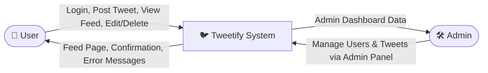
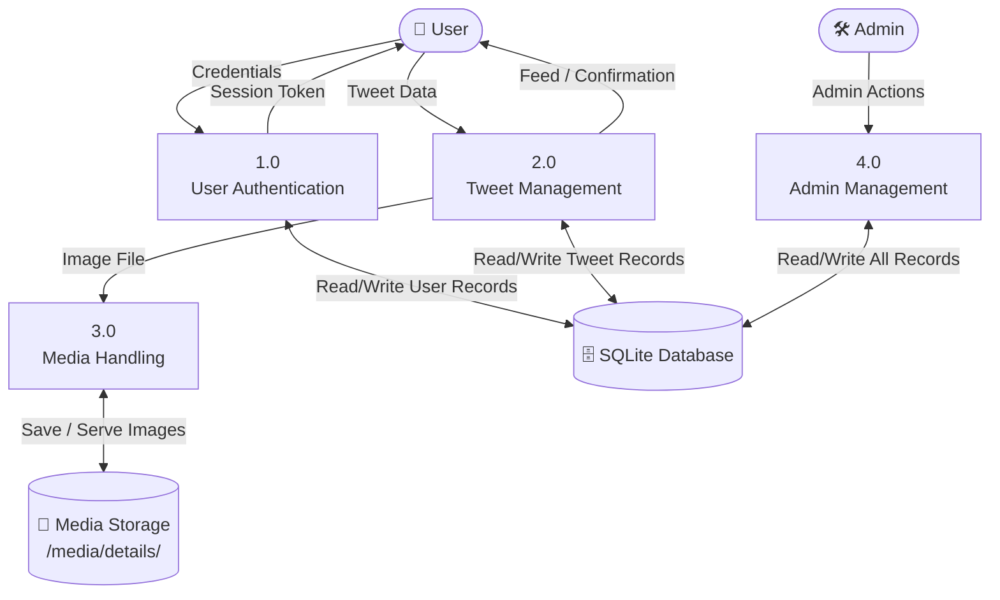
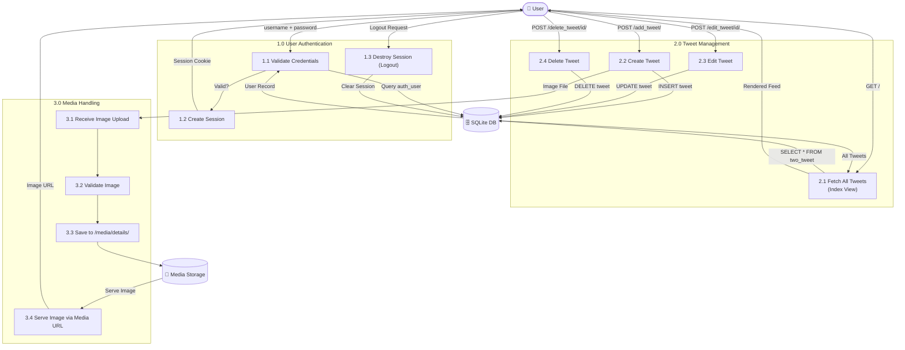
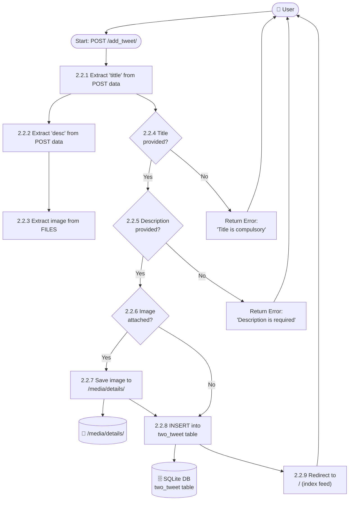
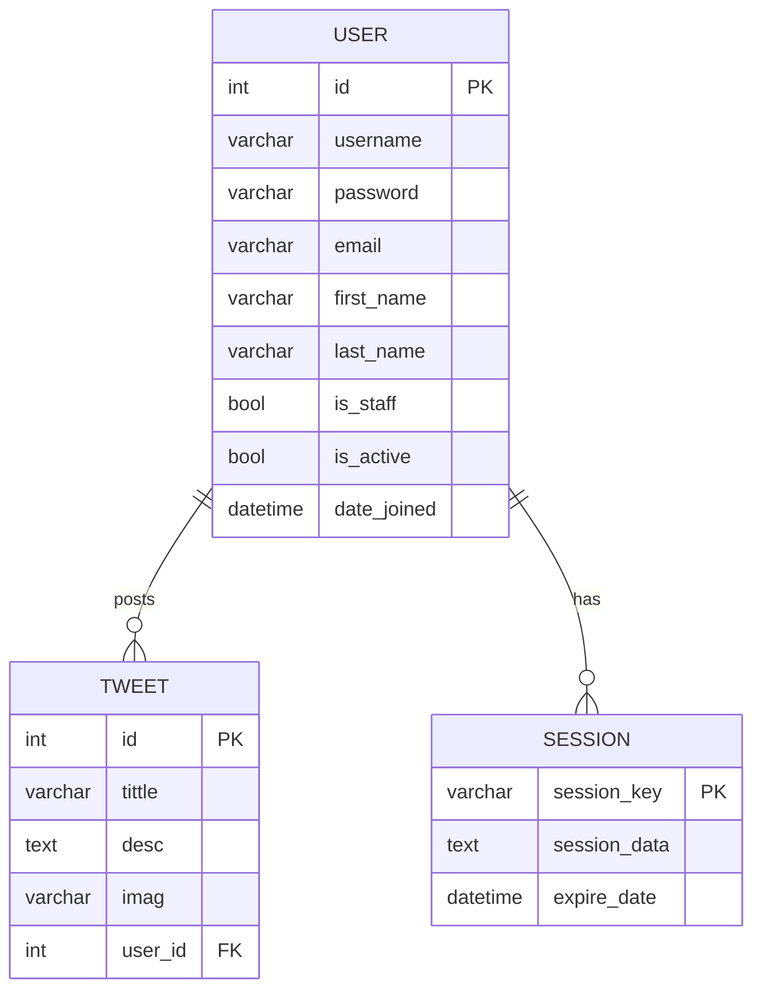

# Tweetify — Project Report

---

## 1. Project Proposal

### Project Title
**Tweetify** — A Django-Based Social Media Micro-Blogging Web Application

### Project Overview
Tweetify is a web-based micro-blogging platform inspired by Twitter/X, built using the Django framework. The application allows users to register, log in, and post short messages ("tweets") that may include a title, description, and an optional image. Other users can view, edit, or delete these posts through a simple and intuitive feed interface.

This project is developed as a full-stack web application using Python and Django on the backend, SQLite as the database, and HTML/CSS with Django Templates on the frontend.

### Objectives
- Build a functional CRUD-based social posting system
- Implement user authentication (login/logout) using Django's built-in auth system
- Support media uploads (images) attached to tweets
- Provide a clean, responsive feed where all posts are visible
- Demonstrate the MVC (Model-View-Template) architectural pattern using Django

### Scope
- User login and session management
- Creating, reading, updating, and deleting tweets
- Image upload and storage
- Public tweet feed (all tweets visible to any visitor)
- Django admin panel for superuser management

---

## 2. Problem Statement

### Background
In today's digital world, people want quick, easy ways to share their thoughts, opinions, and updates with others. Existing platforms like Twitter are powerful but complex, making it difficult for developers or small communities to run their own self-hosted micro-blogging system.

### The Problem
There is no simple, lightweight, self-hosted micro-blogging tool that:
- Allows individuals or small groups to post short text + image updates
- Is easy to deploy and maintain without relying on third-party platforms
- Gives the owner full control over data and content
- Can be customised and extended as needed

Most people rely on commercial social platforms which:
- Collect and sell user data
- Impose algorithmic feeds and content restrictions
- Provide no control over data storage or moderation

### Problem Summary
> **How can we build a simple, self-hosted micro-blogging platform that gives users full control over their posts, media, and data — without depending on commercial social media services?**

---

## 3. Solution

### What Tweetify Solves
Tweetify addresses the problem by providing a minimal, self-hosted social posting platform with these solutions:

| Problem                              | Solution                                              |
|--------------------------------------|-------------------------------------------------------|
| No control over data                 | All data stored locally in SQLite database            |
| Complex platforms hard to self-host  | Django makes deployment straightforward               |
| No image support in simple tools     | Django ImageField with Pillow handles media uploads   |
| No authentication in basic tools     | Django's built-in auth system for login/logout        |
| Commercial platforms monetise users  | Fully open, no ads, no tracking                       |

### How It Works (Summary)
1. A user visits the home feed and sees all existing tweets
2. They log in using their credentials
3. They can create a new tweet with a title, description, and optional image
4. All tweets are stored in SQLite and displayed on the feed
5. Any tweet can be edited or deleted through the interface
6. Media images are stored on the server under `media/details/`

---

## 4. Data Flow Diagrams (DFD)

### Level 0 — Context Diagram
> Shows the system as a single process and its interaction with external entities.

---

### Level 1 — System Decomposition
> Breaks the system into its major processes.

---

### Level 2 — Process Breakdown
> Expands each Level 1 process into sub-processes.

---

### Level 3 — Detailed Sub-Process: Tweet Creation
> Drills into the most critical process: creating a tweet.

---

## 5. Entity-Relationship (ER) Diagram

### ER Diagram Notes

| Entity    | Description                                                              |
|-----------|--------------------------------------------------------------------------|
| `USER`    | Django's built-in `auth_user` table. Stores login credentials and profile info. |
| `TWEET`   | The core content table (`two_tweet`). Each tweet belongs to one user.    |
| `SESSION` | Django's session table. Tracks logged-in user sessions.                  |

**Relationships:**
- One **User** can post **zero or many Tweets** (one-to-many)
- One **User** can have **zero or many Sessions** (one-to-many)
- Each **Tweet** belongs to **one User** (via `user_id` foreign key, nullable)

---

## 6. Summary

| Section         | Detail                                              |
|-----------------|-----------------------------------------------------|
| Platform        | Web Application                                     |
| Language        | Python 3.10+                                        |
| Framework       | Django 5.0                                          |
| Database        | SQLite                                              |
| Architecture    | MVC / MVT (Model-View-Template)                     |
| DFD Levels      | Level 0 (Context), Level 1, Level 2, Level 3        |
| Key Entities    | User, Tweet, Session                                |
| Core Feature    | CRUD micro-blogging with image uploads and auth     |
